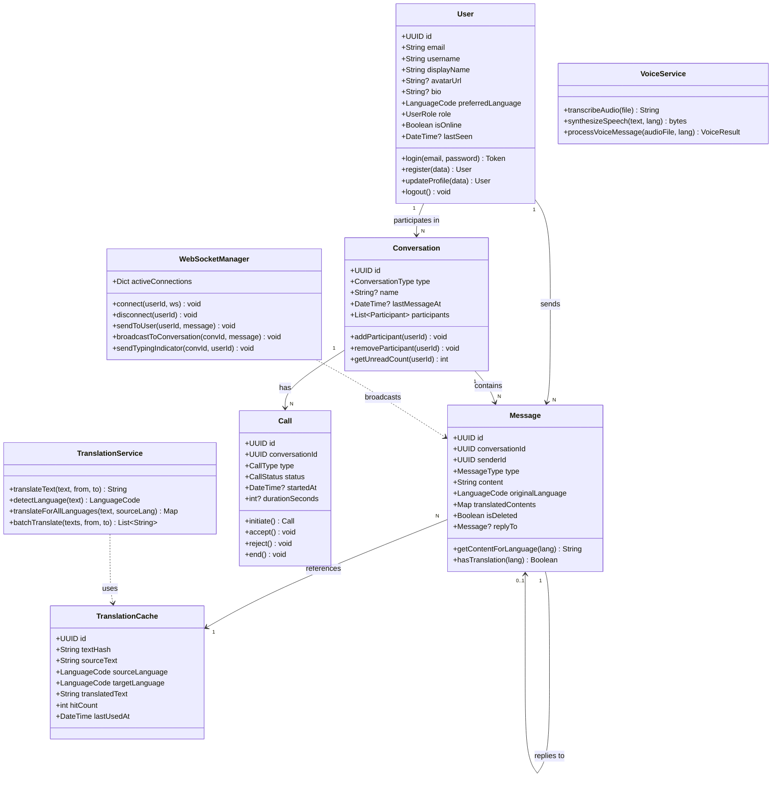
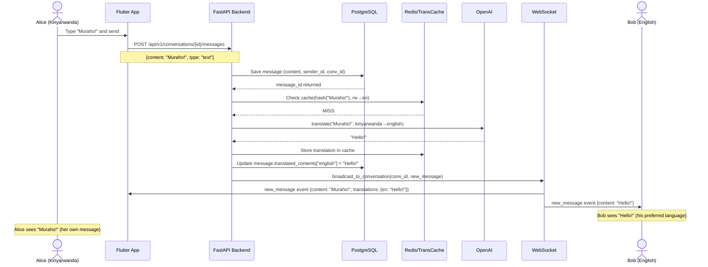
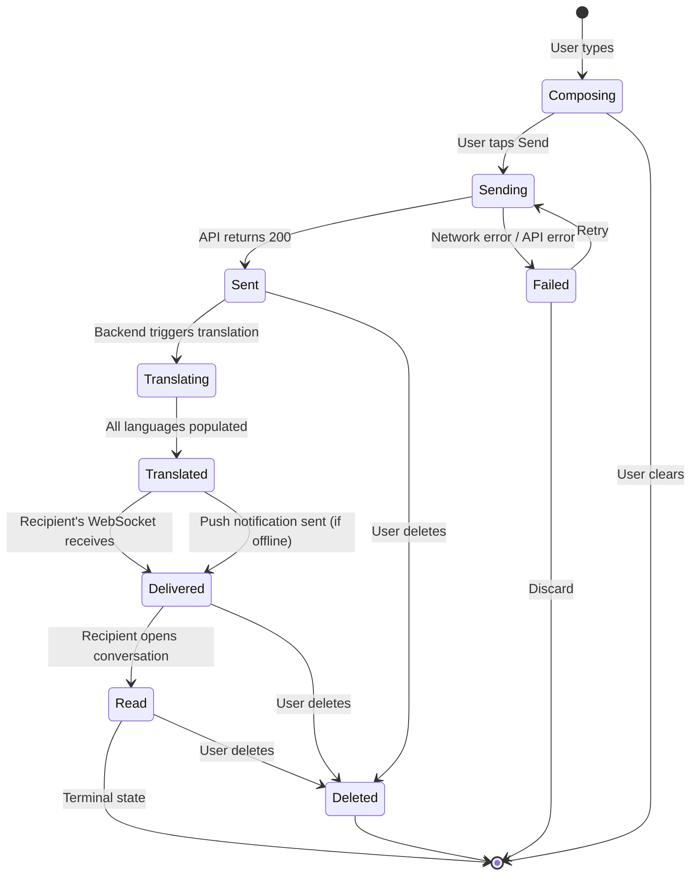
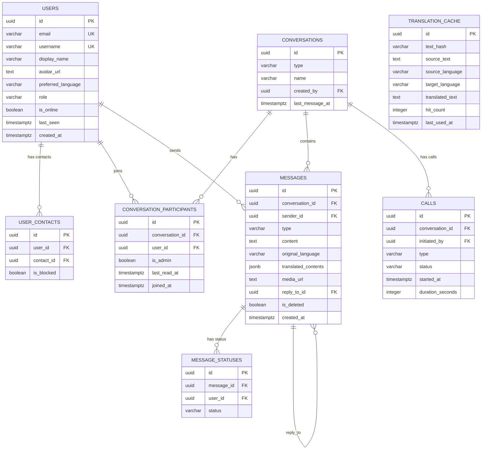
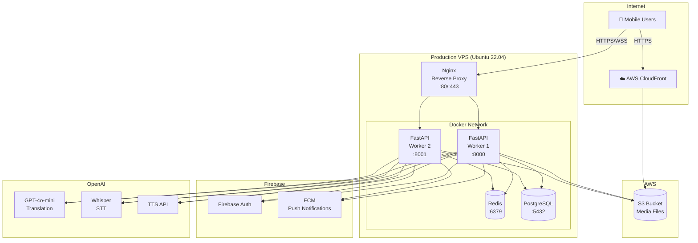

# Ubumwe Connect — UML Diagrams

All diagrams are written in [Mermaid](https://mermaid.js.org/) syntax. Render them at [mermaid.live](https://mermaid.live) or in any Markdown viewer with Mermaid support.

---

## 1. Use Case Diagram

```mermaid
graph TB
    subgraph Actors
        U[👤 User]
        A[🔑 Admin]
        AI[🤖 AI Services]
    end

    subgraph Authentication
        UC1[Register Account]
        UC2[Login / Logout]
        UC3[Google Sign-In]
        UC4[Reset Password]
    end

    subgraph Messaging
        UC5[Send Text Message]
        UC6[Send Voice Message]
        UC7[Send Image/File]
        UC8[Reply to Message]
        UC9[View Translated Message]
        UC10[See Original Message]
        UC11[Create Group Chat]
    end

    subgraph Translation
        UC12[Auto-Translate Message]
        UC13[Set Preferred Language]
        UC14[Detect Language]
    end

    subgraph Calls
        UC15[Make Voice Call]
        UC16[Make Video Call]
        UC17[View Live Subtitles]
        UC18[Accept/Decline Call]
    end

    subgraph Profile
        UC19[Edit Profile]
        UC20[Upload Avatar]
        UC21[Manage Contacts]
        UC22[Block/Unblock User]
    end

    subgraph Admin
        UC23[View Analytics Dashboard]
        UC24[Manage Users]
        UC25[Monitor Translation Stats]
    end

    U --> UC1 & UC2 & UC3 & UC4
    U --> UC5 & UC6 & UC7 & UC8 & UC9 & UC10 & UC11
    U --> UC13 & UC15 & UC16 & UC17 & UC18
    U --> UC19 & UC20 & UC21 & UC22
    A --> UC23 & UC24 & UC25

    UC5 -.->|includes| UC12
    UC6 -.->|includes| UC14
    UC12 -.->|uses| AI
    UC14 -.->|uses| AI
    UC17 -.->|uses| AI
```



---

## 2. Class Diagram



---

## 3. Sequence Diagram — Send & Translate Message



---

## 4. Sequence Diagram — WebRTC Video Call Setup

```mermaid
sequenceDiagram
    actor Caller
    participant CallerApp as Caller Flutter
    participant Backend
    participant CalleeApp as Callee Flutter
    actor Callee

    Caller->>CallerApp: Tap "Video Call" button
    CallerApp->>Backend: POST /api/v1/calls/initiate
    note over CallerApp,Backend: {conversation_id, type: "video"}
    Backend-->>CallerApp: {call_id, status: "initiated"}

    Backend->>CalleeApp: WS event: incoming_call
    note over Backend,CalleeApp: {call_id, caller_info, type: "video"}
    CalleeApp->>Callee: Show incoming call screen

    Callee->>CalleeApp: Tap "Accept"
    CalleeApp->>Backend: POST /api/v1/calls/{id}/accept
    Backend->>CallerApp: WS event: call_accepted

    CallerApp->>CallerApp: Create RTCPeerConnection + offer
    CallerApp->>Backend: WS: webrtc_signal {type: "offer", sdp: "..."}
    Backend->>CalleeApp: WS: webrtc_signal {type: "offer", sdp: "..."}

    CalleeApp->>CalleeApp: Create RTCPeerConnection + answer
    CalleeApp->>Backend: WS: webrtc_signal {type: "answer", sdp: "..."}
    Backend->>CallerApp: WS: webrtc_signal {type: "answer", sdp: "..."}

    loop ICE Candidate Exchange
        CallerApp->>Backend: WS: ice_candidate {...}
        Backend->>CalleeApp: WS: ice_candidate {...}
        CalleeApp->>Backend: WS: ice_candidate {...}
        Backend->>CallerApp: WS: ice_candidate {...}
    end

    note over CallerApp,CalleeApp: Direct P2P WebRTC connection established
    CallerApp<-->CalleeApp: Audio/Video stream (P2P)

    note over CallerApp: Whisper STT → GPT-4o-mini → live subtitles
```

---

## 5. State Machine — Message Lifecycle



---

## 6. Entity-Relationship Diagram



---

## 7. Deployment Diagram


